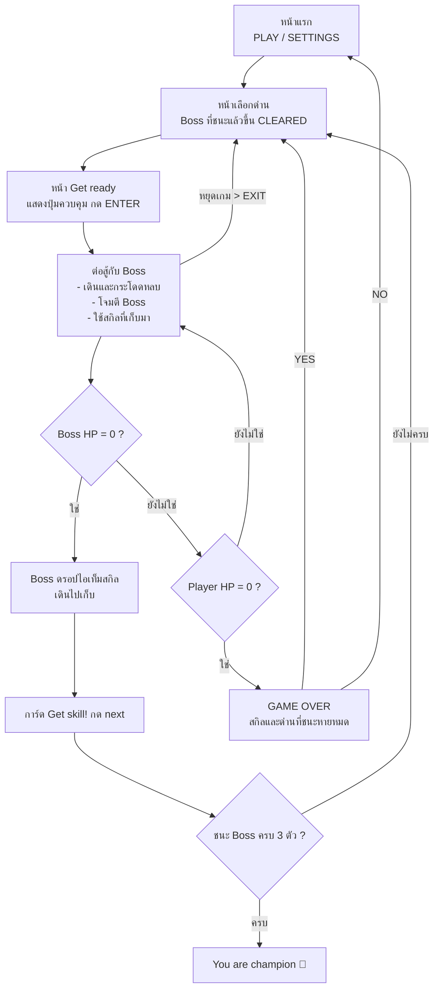

# 🐱 Liquid Cat: Battle of Ken

เกม 2D แนว Action / Boss Fighting ที่ผู้เล่นควบคุมตัวละคร **Liquid Cat** เลือก Boss ที่ต้องการต่อสู้ โดยแต่ละ Boss อยู่คนละด่าน และมีสกิลกับรูปแบบการโจมตีที่แตกต่างกันตามแต่ละด่าน ชนะ Boss แล้วได้สกิลของ Boss ติดตัวไปใช้ในด่านต่อไป

---

## สารบัญ
1. [Game Concept](#1-game-concept)
2. [วิธีรันเกม](#2-วิธีรันเกม)
3. [ปุ่มควบคุม](#3-ปุ่มควบคุม)
4. [Gameplay Loop](#4-gameplay-loop)
5. [Boss ทั้ง 3 ด่าน](#5-boss-ทั้ง-3-ด่าน)
6. [ระบบต่อสู้และสกิลของผู้เล่น](#6-ระบบต่อสู้และสกิลของผู้เล่น)
7. [หน้าจอทั้งหมดในเกม](#7-หน้าจอทั้งหมดในเกม)
8. [Animation ของ Boss](#8-animation-ของ-boss)
9. [โครงสร้างไฟล์](#9-โครงสร้างไฟล์)
10. [Roles / Responsibilities](#10-roles--responsibilities)

---

## 1. Game Concept

| หัวข้อ | รายละเอียด |
|---|---|
| **ชื่อเกม** | Liquid Cat: Battle of Ken |
| **แนวเกม (Genre)** | Action / Boss Fighting (แอ็กชัน ต่อสู้กับ Boss) |
| **รูปแบบ** | 2D |
| **แนวคิดหลัก** | เลือก Boss ตัวไหนก่อนก็ได้ ชนะครบทั้ง 3 ตัวเป็น champion |
| **เทคโนโลยี** | Java + [libGDX](https://libgdx.com/) (desktop: LWJGL3), build ด้วย Gradle |

**จุดเด่น:** Boss แต่ละตัวมีสกิลและรูปแบบการโจมตีแตกต่างกัน ผู้เล่นต้องปรับวิธีเล่นให้เหมาะกับแต่ละตัว และสกิลที่ได้จาก Boss ตัวก่อนช่วยให้สู้ตัวต่อไปง่ายขึ้น จึงต้องคิดว่าจะตีตัวไหนก่อน

---

## 2. วิธีรันเกม

ต้องมี Java (JDK) ติดตั้งไว้ แล้วรันในโฟลเดอร์โปรเจกต์:

```bash
# Windows
gradlew.bat lwjgl3:run

# macOS / Linux
./gradlew lwjgl3:run
```

สร้างไฟล์ `.jar` ไว้เล่นแบบไม่ต้องใช้ Gradle: `gradlew lwjgl3:jar` (ไฟล์จะอยู่ที่ `lwjgl3/build/libs/`)

---

## 3. ปุ่มควบคุม

| ปุ่ม | หน้าที่ |
|---|---|
| **A / D** หรือ **← / →** | เดิน |
| **W** หรือ **↑** | กระโดด |
| **E** | โจมตีปกติ |
| **Q** | สกิล Shield (ได้จาก Boss ด่าน 1) |
| **F** | สกิล Giant Candy (ได้จาก Boss ด่าน 2) |
| **C** | สกิล Code Breath (ได้จาก Boss ด่าน 3) |
| **P** หรือ **ESC** (ระหว่างสู้) | หยุดเกม |
| **ENTER** / คลิก | ยืนยัน, เริ่มสู้, next |
| **Y / N** | เล่นต่อ / ออก (หน้า Game Over) |
| **R** | เล่นใหม่ (หน้า champion) |
| **ESC** (ในเมนู) | ย้อนกลับ |
| **H / J** (ระหว่างสู้) | ลด / เพิ่ม HP ผู้เล่นครั้งละ 10 (ปุ่มสำหรับทดสอบ) |

---

## 4. Gameplay Loop

### เกมเกี่ยวกับอะไร
ผู้เล่นควบคุม Liquid Cat เลือก Boss ที่ต้องการ แล้วเข้าไปต่อสู้ ต้องเดิน กระโดดขึ้นแท่นลอย หลบสกิลของ Boss และโจมตีจน HP ของ Boss เหลือ 0

### Flow การเล่น



### ลำดับการตี Boss
- ตี Boss **ตัวไหนก่อนก็ได้** เช่น 2 → 3 → 1
- ชนะแล้วกด **next** จะกลับไปหน้าเลือกด่าน Boss ที่ชนะแล้วจะมืดลง ขึ้น **CLEARED** และเลือกไม่ได้
- หน้า **You are champion** ขึ้นเมื่อชนะ **ครบทั้ง 3 ตัว** เท่านั้น ไม่ได้ขึ้นอยู่กับว่าตีด่านไหนเป็นตัวสุดท้าย

### เงื่อนไขการชนะ
- ชนะ Boss ครบทั้ง 3 ด่าน → **You are champion** (แสดงสกิลทั้งหมดที่เก็บได้)

### เงื่อนไขการแพ้
- HP ของผู้เล่นเหลือ 0 → **GAME OVER**
- สกิลที่เก็บมาและด่านที่ชนะแล้วจะหายหมด ต้องเริ่มใหม่

### ความคืบหน้าเก็บไว้เมื่อไหร่

| สถานการณ์ | ด่านที่ชนะ + สกิล |
|---|---|
| กด BACK ที่หน้าเลือกด่านไปหน้าแรก แล้วกด PLAY อีกครั้ง | เก็บไว้ |
| หยุดเกมแล้วกด EXIT ออกจากการต่อสู้ | เก็บไว้ |
| แพ้ แล้วเลือก YES หรือ NO | ล้างหมด |
| เป็น champion แล้วกด R หรือ ESC | ล้างหมด |

ความคืบหน้าอยู่แค่ตอนที่เปิดเกมไว้ ปิดเกมแล้วจะไม่ถูกบันทึก

---

## 5. Boss ทั้ง 3 ด่าน

กฎที่ Boss ทุกตัวมีเหมือนกัน: ขยับขึ้นลงเองด้วยความเร็วปานกลาง ยิงเลเซอร์ (มีเส้นเตือนก่อน 1.2 วินาที) มีสกิลพิเศษของตัวเอง และดรอปสกิลให้ผู้เล่นเมื่อถูกกำจัด ทุกด่านมีแท่นลอยฟ้าไว้กระโดดหลบสกิลของ Boss

### Stage 1: Flame Devil (Dis Math, EASY)

| หัวข้อ | รายละเอียด |
|---|---|
| **HP** | 150 |
| **สกิล 1: Magma** | แม็กม่าตกลงมาตรงจุดสุ่มบนแผนที่ทุก 2 วินาที (มีวงเตือนบนพื้น) ทำดาเมจ 15 |
| **สกิล 2: Laser** | เลเซอร์ 1 เส้น ความสูงสุ่ม ทุก 5 วินาที ทำดาเมจ 20 |
| **สกิล 3: Shield** | โล่รอบตัว Boss เป็นอมตะ 3 วินาที ทุก 10 วินาที (หลอด HP เปลี่ยนเป็นสีฟ้า) |
| **ดรอป** | Shield: อมตะ 3 วินาที, cooldown 10 วินาที (ปุ่ม **Q**) |

### Stage 2: `final class Teacher` (OOP, NORMAL)

| หัวข้อ | รายละเอียด |
|---|---|
| **HP** | 300 |
| **สกิล 1: Candy** | โยนลูกอมไปตกจุดสุ่มบนแผนที่ทุก 2 วินาที (มีวงสีชมพูเตือนจุดตก) ทำดาเมจ 15 |
| **สกิล 2: Double laser** | เลเซอร์ 2 เส้น (ล่าง 1 บน 1) ความสูงสุ่ม ทุก 5 วินาที ทำดาเมจ 20 |
| **สกิล 3: Giant candy** | โยนลูกอมยักษ์ไปตกจุดสุ่มทุก 10 วินาที ทำดาเมจ 30 |
| **ดรอป** | Giant Candy: โยนลูกอมยักษ์ไปข้างหน้า ทำดาเมจ 50, cooldown 10 วินาที (ปุ่ม **F**) |

### Stage 3: Bug Hacker (Web, HARD)

| หัวข้อ | รายละเอียด |
|---|---|
| **HP** | 500 |
| **สกิล 1: Energy pulse** | คลื่นพลังระเบิดตรงจุดสุ่มบนแผนที่ทุก 2 วินาที (มีวงจุดสีฟ้าหมุนเตือน 0.9 วินาที) ทำดาเมจ 15 |
| **สกิล 2: Lane laser** | เลเซอร์ 3 เส้นบน 4 ช่อง (พื้น + แท่นลอย 3 ระดับ) ทุก 5 วินาที เว้นช่องปลอดภัย 1 ช่อง (สีเขียวมีลูกศร) เตือนก่อน 1.5 วินาที ทำดาเมจ 20 |
| **สกิล 3: Code breath** | พ่นคลื่นโค้ดที่ความสูงสุ่มทุก 15 วินาที ถ้าโดน HP ผู้เล่นจะลดลงครึ่งหนึ่ง (ของ HP ที่เหลืออยู่) |
| **ดรอป** | Code Breath: พ่นคลื่นโค้ดไปข้างหน้า ลด HP ของ Boss ลงครึ่งหนึ่ง, cooldown 15 วินาที (ปุ่ม **C**) |

---

## 6. ระบบต่อสู้และสกิลของผู้เล่น

### Liquid Cat
- HP 100
- โจมตีปกติ (ปุ่ม **E**): ทำดาเมจ 10 ยิงได้ 5 ครั้งติดกัน แต่ละครั้งห่างกัน 0.5 วินาที แล้วรอ reload 2 วินาที (HUD แสดงจำนวนนัดที่เหลือ)
- โดนโจมตีแล้วเป็นอมตะ 1 วินาที (ตัวกระพริบ)
- การเช็กว่าโดนโจมตีไหม ใช้ตำแหน่งตัวแมวที่เห็นบนจอ (`Player.getBounds()`)
- ทุกด่านมีแท่นลอยแบบ one-way ไว้กระโดดหลบ

### สกิลที่ได้จาก Boss

| สกิล | ได้จาก | ปุ่ม | ผล | Cooldown |
|---|---|---|---|---|
| **Shield** | Flame Devil | Q | อมตะ 3 วินาที | 10 วินาที |
| **Giant Candy** | Teacher | F | โยนลูกอมยักษ์ไปข้างหน้า ดาเมจ 50 | 10 วินาที |
| **Code Breath** | Bug Hacker | C | ลด HP ของ Boss ลงครึ่งหนึ่ง | 15 วินาที |

- สกิลที่เก็บได้แสดงเป็นช่องสกิลบนจอ พร้อมเวลา cooldown
- สกิลติดตัวไปทุกด่านจนกว่าจะแพ้หรือจบเกม (cooldown รีเซ็ตทุกครั้งที่เริ่มด่าน)

---

## 7. หน้าจอทั้งหมดในเกม

| หน้าจอ | รายละเอียด | ไฟล์ |
|---|---|---|
| **หน้าแรก (Title)** | โลโก้ + ปุ่ม **PLAY** และ **SETTINGS** (ชี้แล้วขยาย กดแล้วหด มีเสียงคลิก) ย้ายมาจาก branch `Game` (JavaFX ของ N'Game) แล้วเขียนใหม่ด้วย libGDX | `TitleScreen.java` |
| **Settings** | กรอบไม้ ปรับเสียงเพลง (Music) และเสียงเอฟเฟกต์ (Sound: เสียงคลิก เสียงโจมตี เสียงโดนดาเมจ) ด้วยแถบเลื่อนหรือปุ่ม - / + | `TitleScreen.java`, `GameAudio.java` |
| **เลือกด่าน (Stage select)** | คลิกหลอดแก้ว (หรือ A/D) แล้วกด **PUSH START** (หรือ ENTER) หลอดที่เลือกมีแสงสีเขียวรอบ ๆ, Boss ที่ชนะแล้วขึ้น **CLEARED** เลือกไม่ได้, ปุ่ม **BACK** กลับหน้าแรก, ไอคอน **i** เปิดคู่มือ | `StageSelectScreen.java`, `CyberButton.java` |
| **How to play** | คู่มือ: ปุ่มควบคุม, ระบบต่อสู้, วิธีเล่น และข้อมูล Boss ทั้ง 3 ตัว เลื่อนด้วย mouse wheel, W/S หรือลากแถบเลื่อน | `HowToPlayScreen.java` |
| **Get ready** | ขึ้นก่อนเริ่มสู้ทุกด่าน แสดงปุ่มควบคุมและคำแนะนำ เกมจะหยุดรอจนกด ENTER หรือคลิก | `StageIntro.java` |
| **หยุดเกม (Pause)** | ไอคอนหยุดใต้หลอด HP ของ Boss (หรือ P / ESC) มีปุ่ม **CONTINUE** กลับไปสู้ และ **EXIT** กลับหน้าเลือกด่าน | `PauseMenu.java` |
| **HUD ระหว่างสู้** | หลอด HP ของผู้เล่นและ Boss, จำนวนนัดโจมตีที่เหลือ, ช่องสกิล + cooldown | `GameHud.java`, `HpPlayer.java` |
| **Get skill!** | การ์ดแสดงรายละเอียดสกิลที่เพิ่งเก็บ กด **next** (หรือ ENTER) | `GameHud.java` |
| **GAME OVER** | สไตล์ตู้เกม "CONTINUE ?" เลือก **YES** (กลับหน้าเลือกด่าน) / **NO** (กลับหน้าแรก) ด้วย A/D + ENTER, Y / N หรือคลิก | `GameOverScreen.java` |
| **You are champion** | ขึ้นเมื่อชนะครบ 3 ตัว แสดงสกิลทั้งหมดที่เก็บได้ กด **R** เล่นใหม่ หรือ **ESC** กลับหน้าแรก | `GameHud.java` |

### เสียง
- เพลง `bgfighting.mp3` เล่นวนตลอดเกม
- เสียงคลิกปุ่มในเมนู: `click.mp3`
- เสียงโจมตี: `player_attack.wav` (แมวกด E หรือใช้สกิล) และ `boss_attack.wav` (Boss ยิงเลเซอร์หรือใช้สกิลพิเศษ)
- เสียงโดนดาเมจ: `player_hurt.wav` (HP แมวลด) และ `boss_hurt.wav` (HP Boss ลด)
- ระดับเสียงปรับได้ที่ SETTINGS (Sound) เปลี่ยนเสียงได้โดยวางไฟล์ชื่อเดิมทับใน `assets/sounds/`

---

## 8. Animation ของ Boss

Boss แต่ละตัวมีรูปเดียว จึงทำแอนิเมชันด้วยโค้ดใน `Boss.drawAnimatedBody()` โดยวาดรูปเป็นแถบแนวนอน 32 แถบที่ขยับไม่เท่ากัน ตัว Boss เลยดุ๊กดิ๊กเหมือนเยลลี่
- **Idle:** หายใจ ยืด-หด และโยกตัวไปมา
- **ใช้สกิล:** ยืดตัวขึ้น Teacher จะเอนตัวไปทางผู้เล่นตอนโยนลูกอม (ลูกอมยักษ์เอนแรงกว่า) ส่วน Devil ยืดตัวตรงตอนเรียกแม็กม่าหรือโล่
- **ชาร์จเลเซอร์:** ตัวสั่นและกระพริบสีแดง พอยิงจะเด้งถอยหลัง
- **โดนตี:** ตัวแดงและถูกผลักถอยไปเล็กน้อย
- **ตาย:** ตัวละลายแบนลงแล้วจางหายไปใน 1.1 วินาที
- **Devil:** ไฟบนหัวกระพริบ

---

## 9. โครงสร้างไฟล์

```
core/src/main/java/io/github/game/
├── Main.java               ลูปหลักของเกม, สถานะเกม, ลำดับด่าน, ด่านที่ชนะแล้ว
├── Player.java             ตัวแมว: ตำแหน่ง ความเร็ว HP อมตะหลังโดนตี
├── CatAnimation.java       แอนิเมชันของแมว
├── HpPlayer.java           หลอด HP ของผู้เล่น
├── SkillEffect.java        โจมตีปกติ (ปุ่ม E)
├── GameWorld.java          แรงโน้มถ่วง พื้น และแท่นลอยแบบ one-way
├── FloatingPlatforms.java  แท่นลอยฟ้าในด่าน
├── Boss.java               คลาสแม่ของ Boss ทุกตัว (การเคลื่อนที่ เลเซอร์ HP โล่ แอนิเมชัน)
├── DevilBoss.java          Boss ด่าน 1
├── TeacherBoss.java        Boss ด่าน 2
├── HackerBoss.java         Boss ด่าน 3
├── BossLaser.java          เลเซอร์: เล็งผู้เล่น, สุ่ม 1 เส้น, สุ่ม 2 เส้น, 3 ช่องเว้นช่องปลอดภัย
├── SkillType.java          ข้อมูลสกิลที่ดรอป (ชื่อ ปุ่ม cooldown คำอธิบาย)
├── PlayerSkills.java       เก็บและใช้สกิลของผู้เล่น
├── SkillDrop.java          ไอเท็มสกิลที่ Boss ดรอป
├── GameHud.java            HUD, การ์ด Get skill, หน้า champion
├── TitleScreen.java        หน้าแรก + Settings
├── GameAudio.java          เพลง เสียงคลิก เสียงโจมตีและเสียงโดนดาเมจ
├── StageSelectScreen.java  หน้าเลือกด่าน (CLEARED / LOCKED)
├── HowToPlayScreen.java    คู่มือการเล่น
├── StageIntro.java         หน้า Get ready ก่อนสู้
├── PauseMenu.java          เมนูหยุดเกม
├── GameOverScreen.java     หน้า GAME OVER
└── CyberButton.java        ปุ่ม BACK สไตล์ cyber ที่ใช้ร่วมกันหลายหน้า

assets/
├── boss/          รูป Boss
├── skills/        ไอคอนสกิล
├── cat_frames/    เฟรมแอนิเมชันของแมว
├── effect/        เอฟเฟกต์การโจมตี
├── hp_player/     รูปหลอด HP ของผู้เล่น
├── title/         รูปหน้าแรก
├── sounds/        เพลงและเสียง
└── select_stage.jpg, platform.png, icon.png (ไอคอนคู่มือ), icon2.png (ไอคอนหยุดเกม)
```

**เพิ่ม Boss ตัวใหม่:** สร้างคลาสที่ extends `Boss` แล้วเพิ่มใน `Main.createBoss()` และเพิ่มค่า `STAGE_COUNT`

---

## 10. Roles / Responsibilities

| สมาชิก | หน้าที่ |
|---|---|
| **Prem** | Player movement, attack system, และ player animation |
| **kendo** | Boss design, boss skills, AI และ combat system |
| **Polly** | Level design, boss selection และ game progression |
| **N'Game** | UI, graphics, sound effects และ game menu |
